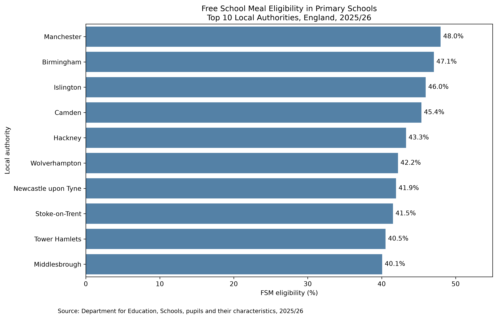

# Educational Inequality in England: Data Analysis

**Exploring Free School Meal Eligibility in Primary Schools (2025/26)**

Python | pandas | Seaborn | Matplotlib | Jupyter Notebook

## Project Overview

This project explores geographical differences in Free School Meal (FSM) eligibility among pupils attending state-funded primary schools across England.

Using official Department for Education (DfE) data, I applied Python to clean, organise, analyse and visualise educational statistics.

**Research question:** How does FSM eligibility vary across English local authorities?

## Dataset & Methodology

**Source:** [Department for Education — Schools, pupils and their characteristics, 2025/26](https://explore-education-statistics.service.gov.uk/data-catalogue/data-set/49362fcb-2c48-4cf9-9a93-d676e390f3d7)

The original dataset contained **95,323 records and 17 variables**.

The analysis involved:

- Identifying missing values and checking for duplicates.
- Filtering records by academic year, geography and school type.
- Selecting the appropriate FSM eligibility measure.
- Preparing a clean dataset covering **152 local authorities**.
- Creating visualisations to explore geographical differences.

## Key Findings

The local authorities with the highest FSM eligibility percentages in the selected dataset were:

| Local authority | FSM eligibility |
|---|---:|
| Manchester | 47.98% |
| Birmingham | 47.06% |
| Islington | 45.95% |
| Camden | 45.38% |
| Hackney | 43.29% |

### Data Visualisation

**Interpretation:** FSM eligibility varies across local authorities. However, eligibility is not a comprehensive measure of child poverty, and these descriptive findings do not establish the causes of geographical differences.

## Skills Demonstrated

**Data Analysis:** Python, pandas, data cleaning, filtering and descriptive analysis.

**Data Visualisation:** Seaborn and Matplotlib.

**Tools:** Jupyter Notebook, VS Code, Git and GitHub.

## Explore the Project

- [Python Analysis Notebook](notebooks/01_data_exploration.ipynb)
- [Cleaned Dataset](outputs/fsm_primary_2025_26_clean.csv)
- [Visualisation](outputs/top10_fsm_eligibility.png)

To reproduce the analysis, download the original DfE CSV into a local `data/` folder, install pandas, Seaborn, Matplotlib and Jupyter, and run the notebook in order.

## Next Steps

Extend the analysis through descriptive statistics, regional comparisons and additional educational indicators.

---

**Author:** [Katherine Baena](https://github.com/katherinebaena)

*Part of my AI, Data Science & Education professional portfolio.*

